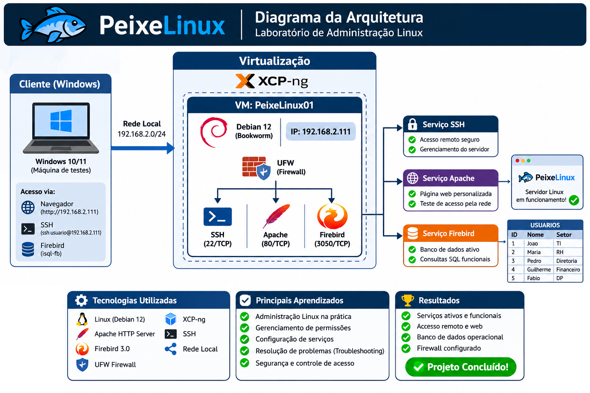

# PeixeLinux — Laboratório de Administração Linux

## Sobre o projeto

O PeixeLinux é um laboratório prático de administração de sistemas Linux desenvolvido para consolidar conhecimentos em infraestrutura, administração de servidores, serviços de rede, permissões, segurança e troubleshooting.

O projeto foi desenvolvido em ambiente virtualizado, utilizando Debian GNU/Linux 12.

## Arquitetura

## Objetivos

- Praticar administração de servidores Linux.
- Gerenciar usuários, grupos e permissões.
- Configurar e administrar serviços.
- Compreender processos, logs e inicialização de serviços.
- Implementar regras de firewall.
- Desenvolver habilidades de diagnóstico e resolução de problemas.
- Documentar procedimentos técnicos e evidências de funcionamento.

## Ambiente utilizado

| Componente | Configuração |
|---|---|
| Sistema operacional | Debian GNU/Linux 12 (Bookworm) |
| Virtualização | Oracle VirtualBox |
| Hipervisor estudado | XCP-ng 8.3 |
| Processadores virtuais | 2 vCPU |
| Memória RAM | 4 GB |
| Armazenamento | 30 GB |
| Rede | Bridge |
| Endereço IP | 192.168.2.111 |

## Tecnologias e serviços

- Linux
- SSH
- Apache HTTP Server
- Firebird 3.0
- UFW (Uncomplicated Firewall)
- systemd
- Bash e comandos de administração Linux

## Atividades desenvolvidas

### Administração do sistema
- Criação e gerenciamento de usuários e grupos.
- Administração de permissões e propriedade de arquivos.
- Configuração de diretórios compartilhados e SGID.
- Administração de serviços e processos.

### Rede e acesso remoto
- Configuração e validação de rede.
- Administração do serviço SSH.
- Testes de conectividade entre máquinas.
- Verificação de portas TCP em escuta.

### Serviços
- Instalação e configuração do Apache.
- Publicação de página HTML personalizada.
- Instalação e configuração do Firebird.
- Criação e manipulação de banco de dados.
- Execução de consultas SQL.

### Segurança
- Configuração do UFW.
- Liberação controlada das portas SSH (22), HTTP (80) e Firebird (3050).
- Política padrão de entrada: negar.
- Política padrão de saída: permitir.
- Testes de acesso e conectividade.

### Troubleshooting
- Diagnóstico de falha de acesso ao banco Firebird.
- Análise de permissões e propriedade dos arquivos.
- Correção da propriedade dos bancos para o usuário e grupo Firebird.
- Validação da conexão ao banco e consulta aos registros.
- Análise de serviços com systemctl.
- Inspeção de portas em escuta com ss.
- Verificação de logs e estados dos serviços.

## Testes realizados

| Teste | Resultado |
|---|---|
| SSH ativo | Validado |
| Apache ativo | Validado |
| Firebird ativo | Validado |
| Porta TCP 22 | Conectividade confirmada |
| Porta TCP 80 | Conectividade confirmada |
| Porta TCP 3050 | Conectividade confirmada |
| Página Apache acessível pela rede | Validado |
| Conexão com banco Firebird | Validado |
| Consulta SQL à tabela USUARIOS | Validado |
| Firewall UFW | Ativo e regras verificadas |

## Aprendizados

O projeto permitiu praticar administração Linux, configuração de serviços, controle de acesso, segurança de rede e resolução de problemas, aproximando os estudos de situações encontradas em ambientes reais de infraestrutura e suporte técnico.

## Status

Em fase de documentação e revisão final.

---

**Projeto desenvolvido como laboratório pessoal de estudos em Infraestrutura e Administração de Sistemas Linux.**
